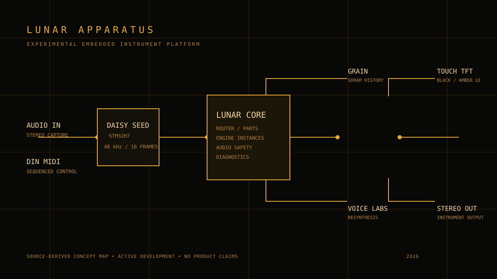

# LUNAR APPARATUS

> An experimental instrument platform for sound capture, resynthesis, and hands-on control.

Lunar Apparatus is an ongoing embedded-instrument project built around the **Daisy Seed / STM32H7** platform. It is a place to test musical behaviours in real hardware: granular playback from captured sound, voice analysis and resynthesis, MIDI-driven sound engines, and a compact touch-screen interface.

This repository is a portfolio view of the work. It intentionally documents the research without presenting unfinished experiments as a product release.

## The apparatus

The current Lunar foundation separates the instrument into practical layers:

| Layer | Current role |
| --- | --- |
| Audio | 48 kHz audio, 16-sample blocks, protected stereo output stage |
| Control | DIN MIDI receive, touch-screen control, and a physical capture button |
| Instrument core | Part routing, fixed engine instances, ordered audio commands, and safe engine transitions |
| Display | A foreground-only TFT/touch interface with black and amber visual language |
| Experiments | Granular capture, voice resynthesis, vocal synthesis, vocoder, wavetable, and speech-oriented studies |

The Daisy implementation uses an ILI9341 display, resistive touch, DIN MIDI over USART1, and the established audio I/O path. The interface and hardware control paths are shared where useful, while experiments remain isolated until there is enough evidence to integrate them.

## Research threads

### Grain

The granular instrument records a rolling stereo history in external SDRAM, then provides raw and granular playback. Its touch interface exposes grain size, density, spray, windowing, pitch spread, stereo spread, scan behaviour, envelopes, and modulation. The goal is an instrument that can move between direct captured sound and a more diffuse, playable texture.

### Voice resynthesis

`VoiceResynthLab` is a separate Daisy Seed experiment for four-second stereo capture and MIDI-sequenced resynthesis. It keeps a RAW reference lane beside distinct PSOLA, spectral, harmonic-plus-noise, and LPC treatments. These are deliberately separate approaches to the same captured material, with their limits documented in the source.

### Multi-engine instrument work

The Lunar foundation currently contains two deliberately simple test engines: a tone voice and a unity stereo-through engine. They exercise the architecture for MIDI routing, per-instance state, switching, fades, audio safety, and display diagnostics. The broader synthesis research remains in separate targets rather than being advertised as a completed integrated engine collection.

### More sound experiments

The project also contains isolated studies in vocal synthesis, a 20-band vocoder wrapper, wavetable generation, and speech-oriented synthesis. Each target has its own boundaries and provenance notes. They are experiments, not claims that every method has been auditioned, integrated, or shipped.

## Development status

| Area | Status |
| --- | --- |
| Lunar routing and test-engine foundation | Source and host-test verified; target builds are available |
| MIDI and hardware integration | Active diagnostic work; hardware behaviour is documented separately from source results |
| Granular instrument | Developed as a dedicated instrument target |
| Voice resynthesis | Dedicated capture/resynthesis experiment |
| Production capture workflow, presets, USB transport, dynamic routing, MPE | Future work |

Build success establishes that code and resource use fit the target. It does not claim listening quality, real-time CPU margin, touch response, or hardware behaviour without a corresponding hardware test.

## Why the black and amber display language?

The visual direction is deliberately utilitarian: black ground, amber information, sparse line work, and controls that should still read like an instrument panel during a session. It supports the project’s lunar/aerospace mood without turning the hardware into a mock mission-control prop.

## What is published here

This showcase contains a source-derived diagram and project documentation only. Firmware, build artifacts, third-party dependencies, and experimental source targets are intentionally not mirrored here. That keeps the public repository focused on the instrument concept while the working research tree remains private.

## Evidence language

Lunar uses explicit evidence labels in its working documentation:

- **SOURCE-PROVEN**: established by reading the implementation.
- **TEST-PROVEN**: established by host or source-boundary tests.
- **COMPILE-PROVEN**: established by a target build.
- **HARDWARE-PROVEN**: established on the physical instrument.

Those are not interchangeable. The distinction is part of the project: embedded instruments are only finished when the code, electronics, interaction, and sound all agree.

---

Created by [Kári Garðarsson](https://github.com/karigardarsson). Lunar Apparatus is an independent maker project in active development.
